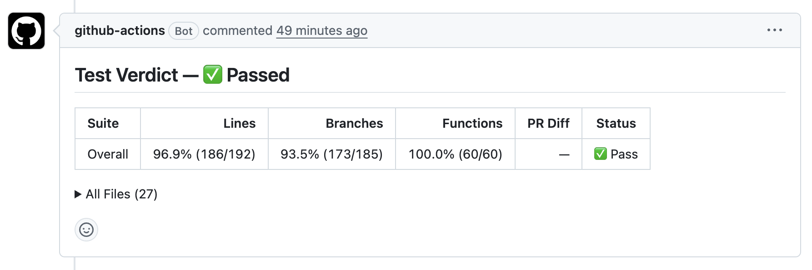

# Customizing the PR Comment Bot Name

By default, PR comments posted by Test Verdict appear under the `github-actions` Bot account. If you prefer PR comments to appear under a branded bot identity (such as `test-verdict` Bot with a custom avatar), you can configure a GitHub App and pass its installation token into the action's `github-token` input.

## Default Behavior

When you use `steveswinsburg/test-verdict@v1` without overriding `github-token`, `action.yml` defaults to `${{ github.token }}` (GitHub's built-in `GITHUB_TOKEN`). GitHub always attributes comments created with `GITHUB_TOKEN` to the `github-actions` Bot account with the standard GitHub Actions avatar:



GitHub does not allow a workflow or Action to override the commenter name or avatar when posting with `GITHUB_TOKEN`. The `title` input (default: `Test Verdict`) only changes the heading inside the comment body, not the comment author shown above it.

## Posting as a Custom Bot Using a GitHub App (Recommended)

To post comments as a custom bot with your own name and icon, create a GitHub App and generate a short-lived installation token in your workflow.

### 1. Create a GitHub App

1. Open your GitHub **Settings** (personal or organization) -> **Developer settings** -> **GitHub Apps** -> **New GitHub App**.
2. Fill in the app details:
   - **GitHub App name**: `Test Verdict` (or any unique name; GitHub displays the app slug with a `Bot` badge, for example `test-verdict` Bot).
   - **Homepage URL**: `https://github.com/steveswinsburg/test-verdict` (or your repository/organization URL).
   - **Webhook**: Uncheck **Active** (webhooks are not required).
3. Under **Permissions** -> **Repository permissions**, grant:
   - **Pull requests**: `Read and write` (allows reading PR diffs and creating/updating PR comments).
4. Under **Where can this GitHub App be installed?**, select **Only on this account** (recommended for your own repositories or organization).
5. Click **Create GitHub App**.
6. (Optional) Under **Display information**, upload a logo such as [test-verdict-shield.png](test-verdict-shield.png) to give the bot a custom avatar.

### 2. Generate a Private Key and Install the App

1. On the app's settings page, note the **App ID** near the top.
2. Scroll down to **Private keys** and click **Generate a private key** to download the `.pem` file.
3. Open **Install App** in the left sidebar and install the app on the repositories (or all repositories in your organization) where you run Test Verdict.

### 3. Add the App ID and Private Key to Repository/Org Settings

In your repository or organization **Settings** -> **Secrets and variables** -> **Actions**:

- Add a **Variable** named `TEST_VERDICT_APP_ID` with the App ID.
- Add a **Secret** named `TEST_VERDICT_APP_PRIVATE_KEY` with the full contents of the downloaded `.pem` file.

### 4. Update Your Workflow

Use `actions/create-github-app-token@v2` to mint an installation token and pass it to `github-token`:

```yaml
name: Coverage Gate

on:
  pull_request:

permissions:
  contents: read

jobs:
  test:
    runs-on: ubuntu-latest
    steps:
      - uses: actions/checkout@v4
      - run: npm test -- --coverage

      - name: Generate Test Verdict App token
        id: app-token
        uses: actions/create-github-app-token@v2
        with:
          app-id: ${{ vars.TEST_VERDICT_APP_ID }}
          private-key: ${{ secrets.TEST_VERDICT_APP_PRIVATE_KEY }}

      - uses: steveswinsburg/test-verdict@v1
        with:
          files: coverage/lcov.info
          min-line: 80
          min-diff-line: 90
          github-token: ${{ steps.app-token.outputs.token }}
```

## Notes and Caveats

- **Existing PR comments**: Sticky comments are matched by the hidden marker `<!-- test-verdict:<report-id> -->`. Updating an existing comment that was originally created by `github-actions[bot]` will not change its author (and may fail with a permission error when using a different token). Delete the old `github-actions` comment once on any open PR so the next workflow run creates a new comment under your GitHub App bot.
- **Fork pull requests**: GitHub does not expose repository secrets to `pull_request` workflows triggered from forks. If your repository accepts PRs from forks, guard the token step so fork PRs still fall back cleanly to `github.token` (which still writes the Job Step Summary and enforces thresholds):

  ```yaml
        - name: Generate Test Verdict App token
          id: app-token
          if: github.event.pull_request.head.repo.full_name == github.repository
          uses: actions/create-github-app-token@v2
          with:
            app-id: ${{ vars.TEST_VERDICT_APP_ID }}
            private-key: ${{ secrets.TEST_VERDICT_APP_PRIVATE_KEY }}

        - uses: steveswinsburg/test-verdict@v1
          with:
            files: coverage/lcov.info
            min-line: 80
            github-token: ${{ steps.app-token.outputs.token || github.token }}
  ```

- **Workflow `permissions`**: When commenting via a GitHub App token, the workflow's `GITHUB_TOKEN` only needs `contents: read`, because `pull-requests: write` is provided by the App installation token.

## Alternative: Dedicated Machine User (PAT)

You can also create a dedicated GitHub machine user account, generate a fine-grained Personal Access Token (PAT) with `Pull requests: Read and write` permission, and pass it via `github-token: ${{ secrets.TEST_VERDICT_PAT }}`. Compared to a GitHub App, this is generally less convenient because comments do not display a `Bot` badge, tokens require manual rotation, and the machine account may count as a paid seat in GitHub organizations.
